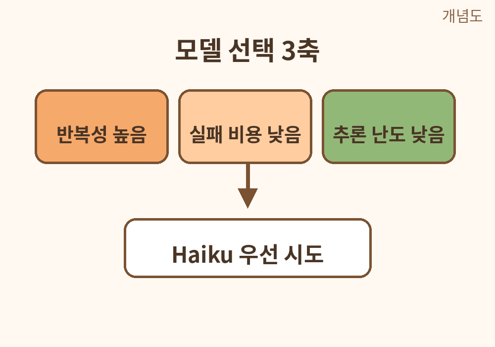
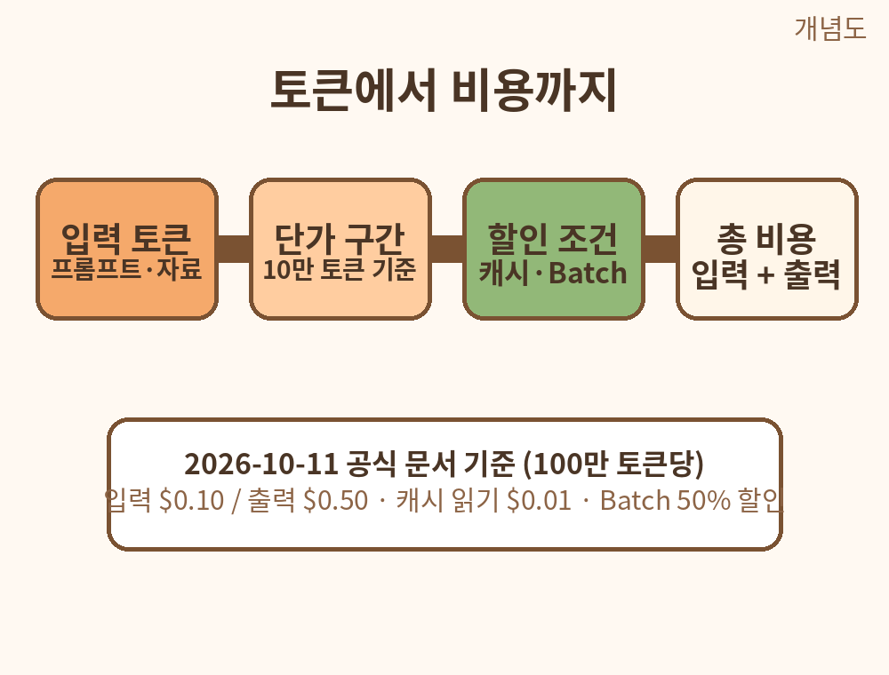
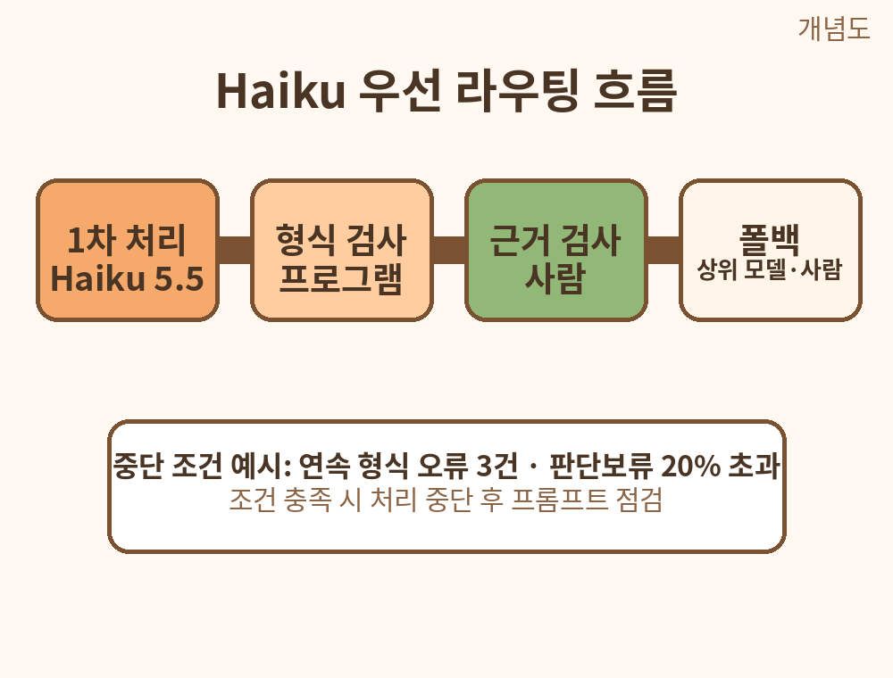

# Claude Haiku 5.5로 저비용 AI 업무 처리하기

반복 요약·분류·추출부터 모델 선택과 비용 검증까지

저자: 이준수 / 이메일: 1130dlwltn2@gmail.com / 작성 기준일: 2026-10-11

---

# 도서 소개

## Claude Haiku 5.5로 저비용 AI 업무 처리하기

반복 요약·분류·추출부터 모델 선택과 비용 검증까지

저자: 이준수
이메일: 1130dlwltn2@gmail.com
작성 기준일: 2026-10-11

Anthropic이 2026-10-07에 공개한 Claude Haiku 5.5를 실무의 반복 텍스트 업무에 적용하는 방법을 다룬 교재다.

이 책은 모델의 기능을 나열하는 대신, 하나의 업무(고객 문의 분류)를 처음부터 끝까지 처리하는 과정을 따라간다. 모델을 고르는 기준(1장), 안전한 실습 환경(2장), 요약(3장)과 분류·추출(4장) 실습, 품질 평가표(5장), 토큰과 비용 계산(6장), 실패에 대비한 라우팅(7장)을 거쳐, 마지막에는 프롬프트·평가표·비용표·운영 기준을 묶은 업무팩(8장)을 만든다.

모든 실습은 가상의 합성 데이터로 진행된다. 실제 고객 정보·API 키·개인정보는 다루지 않는다. 기본 실습은 채팅형 UI에 복사·붙여넣기만으로 따라할 수 있다.

---

# 학습 준비

## 준비물

- 웹 브라우저 (채팅형 Claude UI 접속용)
- 텍스트 편집기 (메모장, VS Code 등 결과 보관용)
- 이 책의 저장소 파일 (data/sample_synthetic_inquiries.csv 포함)

## 선수 지식

기본은 복사·붙여넣기만 필요로 한다. API 실습은 선택 사항이며, 키 관리·JSON·간단한 Python 지식이 있으면 유리하다.

## 학습 진행 방식

1. 장 시작 전 학습 목표와 준비물을 확인한다.
2. 예시를 따라 한 뒤 복사용 프롬프트를 실행한다.
3. 예상 결과와 자신의 결과를 비교한다.
4. 완료 체크표에 기록하고 다음 장으로 진행한다.

## 실습 파일 안내

- data/sample_synthetic_inquiries.csv: 가상 고객 문의 12건. 열은 id, inquiry, gold_label이다. gold_label은 정답 라벨로 5장 평가표에서 대조용으로 쓴다. 파일 첫머리에 UTF-8 BOM이 있으므로 읽을 때는 utf-8-sig 인코딩을 쓴다.
- project/: 8장 최종 프로젝트의 5개 파일이 들어 있다.

## API 키 관리 원칙

실습 예시에 API 키를 넣지 않는다. 키는 코드나 문서에 직접 적지 않고 환경 변수나 비밀 저장소에 둔다. 키가 노출되면 즉시 폐기하고 재발급한다.

## 표기 안내

- 이 책의 가격·기능 수치는 2026-10-11 공식 문서 기준이며 변할 수 있다.
- 벤치마크 수치는 공급사 발표 수치임을 출처·조건과 함께 표시하고 원본을 재배포하지 않는다.
- 직접 확인하지 못한 기능은 미확인으로 표기한다.
- 도식 이미지에는 '개념도' 표시를 붙여 실제 화면 캡처와 구분한다.

---

# 전체 목차

- 표지
- 도서 소개
- 학습 준비
- 목차

- 1장. Haiku·Sonnet·Opus를 고르는 기준
  - 학습 목표: 작업 복잡도·속도·비용·검증 가능성 구분
  - 실습: 업무 10개를 소형/대형 모델 후보로 분류

- 2장. 실습 환경과 안전한 샘플
  - 학습 목표: Claude UI와 API의 차이, 개인정보 보호
  - 실습: 가상 고객 문의 CSV와 평가표 준비 (data/sample_synthetic_inquiries.csv)

- 3장. 빠르고 정확한 요약
  - 학습 목표: 요약 길이와 보존해야 할 사실 명시
  - 실습: 가상 회의록 3개를 100자 요약하고 원문 대조

- 4장. 분류와 정보 추출
  - 학습 목표: 정해진 분류표와 JSON 출력 형식
  - 실습: 문의 12건 분류·우선순위·핵심 키워드 추출

- 5장. 품질 평가표 만들기
  - 학습 목표: 정확도·누락·형식 준수·수정 시간 기록
  - 실습: 정답지와 AI 출력 비교표 작성

- 6장. 토큰과 비용 계산
  - 학습 목표: 토큰 단가·캐시·배치·요청 길이 구간 구분
  - 실습: 가상의 1000건 처리 비용을 수식으로 계산

- 7장. 모델 라우팅과 실패 대안
  - 학습 목표: 쉬운 작업은 소형, 어려운 작업은 검토·상위 모델로 전환
  - 실습: 신뢰도 낮은 결과만 수동 검토하는 라우팅 표 작성

- 8장. 완성 프로젝트: 문의 분류 업무팩
  - 학습 목표: 프롬프트·평가표·비용표·운영 기준 묶기
  - 실습: 가상 문의 12건 자동 분류 매뉴얼과 비용·품질 보고서 작성

- 실습 정답/예시
- FAQ
- 참고 자료
- 마지막 안내

---

# 1장. Haiku·Sonnet·Opus를 고르는 기준

## 학습 목표

1. 업무를 복잡도·속도·비용·검증 가능성의 관점에서 구분할 수 있다.
2. 반복성·실패 비용·추론 난도 세 가지 축으로 업무를 평가할 수 있다.
3. 소형 모델을 우선 시도해도 되는 업무를 판단하고 근거를 말할 수 있다.

## 선행 개념

- 언어 모델: 텍스트를 입력받아 텍스트를 생성하는 소프트웨어. 사람처럼 이해하는 것이 아니라 학습된 패턴으로 다음 토큰을 예측한다.
- 모델 클래스: Anthropic은 같은 세대의 모델을 Haiku·Sonnet·Opus 세 등급으로 제공한다. Haiku는 속도와 비용이 강점인 소형 등급이다.
- 추론 난도: 정답을 내는 데 필요한 판단의 깊이. 단순 정형 작업은 낮고, 다단계 판단이 필요하면 높다.
- 실패 비용: 결과가 틀렸을 때 발생하는 실제 손실. 고객에게 바로 전달되면 높고, 사람이 검토 후 전달하면 낮다.

## 쉬운 설명

Claude Haiku 5.5는 Anthropic이 2026-10-07에 공개한 모델이다. 모델 ID는 claude-haiku-5-5이며, 공개일 기준으로 Haiku 등급의 최신 모델이다. Haiku 등급은 같은 세대의 Sonnet·Opus보다 응답이 빠르고 단가가 낮게 책정되는 것이 특징이다.

모델을 고를 때 흔한 착각은 두 가지다. 첫째, 비싼 모델이 모든 작업에 더 좋은 결과를 낸다고 생각하는 것이다. 정형화된 반복 작업에서는 소형 모델의 출력도 사람 검토를 거치면 충분히 실무 수준이 되는 경우가 많다. 둘째, 단가가 낮으면 전체 비용도 반드시 낮다고 생각하는 것이다. 출력 토큰 수·재시도 횟수·사람 검토 시간까지 합쳐야 실제 비용이 된다.

판단 기준은 단순하다. 반복성이 높고, 실패 비용이 낮으며, 추론 난도가 낮은 업무부터 소형 모델에 맡긴다. 반대로 실패했을 때 손실이 크거나, 판단 근거를 꼼꼼히 따져야 하는 업무는 상위 모델이나 사람의 검토를 붙인다. 이 장의 실습에서는 내 업무 10개를 이 세 축으로 평가하는 표를 만든다.

용어 정리

- 프롬프트: 모델에게 주는 지시문과 입력 자료.
- 출력 토큰: 모델이 생성한 텍스트의 계산 단위. 길어질수록 비용이 는다.
- 검증 가능성: 결과를 원문·정답표·규칙과 대조해 맞았는지 확인할 수 있는 정도.

## 가상 데이터 예시

아래는 가상의 1인 사업자 '한빛문구'가 AI 활용을 검토하는 업무 10개 목록이다. 전부 가상의 예다.

1. 하루 200건의 고객 문의 분류 (배송·결제·사용법·기타)
2. 주간 회의록 3건을 100자 이내로 요약
3. 상품 설명 문구 초안 작성 (신상품 10종)
4. 월간 매출 보고서의 오탈자 검토
5. 고객 불만 메일에 대한 답변 초안 작성
6. 계약서 조항의 리스크 검토
7. SNS 게시글 일정표 작성
8. 상품 리뷰 500건의 긍정·부정 분류와 키워드 추출
9. 세무 관련 문의에 대한 안내문 초안
10. 신입 교육 자료의 목차 설계

## 실습 1. 업무 10개를 소형·대형 모델 후보로 분류하기

1. 위 가상 목록 또는 본인의 실제 업무 10개를 메모장에 적는다. 실제 고객명·금액 같은 민감 정보는 쓰지 않는다.
2. 아래 복사용 프롬프트를 AI에 입력하고 결과를 복사해 별도 Markdown 파일에 보관한다.
3. 각 업무를 반복성(상/중/하)·실패 비용(상/중/하)·추론 난도(상/중/하)로 다시 평가한다.
4. 소형 모델 우선 후보로 분류된 업무 중 실패 비용이 '상'인 것이 있으면 상위 모델 또는 사람 검토를 조건으로 메모한다.

### 복사용 프롬프트

다음 10개 업무를 반복성, 실패 비용, 추론 난도로 평가하고 작은 모델을 우선 시도할 업무를 골라줘.

1. 하루 200건의 고객 문의 분류 (배송·결제·사용법·기타)
2. 주간 회의록 3건을 100자 이내로 요약
3. 상품 설명 문구 초안 작성 (신상품 10종)
4. 월간 매출 보고서의 오탈자 검토
5. 고객 불만 메일에 대한 답변 초안 작성
6. 계약서 조항의 리스크 검토
7. SNS 게시글 일정표 작성
8. 상품 리뷰 500건의 긍정·부정 분류와 키워드 추출
9. 세무 관련 문의에 대한 안내문 초안
10. 신입 교육 자료의 목차 설계

평가 결과는 표로 정리하고, 각 업무에 대해 작은 모델 우선 시도 여부를 '시도 / 조건부 시도 / 상위 모델 권장' 중 하나로 표시해줘.

### 예상 결과

10개 업무가 세 축 평가와 함께 표로 정리된다. 1·2·8번처럼 정형 반복 작업은 '시도'로, 5·6·9번처럼 실패 비용이 크거나 전문 판단이 필요한 작업은 '조건부 시도' 또는 '상위 모델 권장'으로 분류되는 형태가 일반적이다. 조건부 시도는 '사람 검토 후 발송' 같은 조건이 함께 적혀 있다.

## 흔한 오류와 해결책

- 전부 '시도'로 분류됨: 실패 비용을 과소평가한 경우다. 고객에게 직접 전달되는 업무는 기본적으로 실패 비용 '상'으로 두고 시작한다.
- 표 없이 장문의 설명만 나옴: 프롬프트에 '표로 정리해줘'가 빠졌거나 묻혔다. 지시문 마지막에 출력 형식을 다시 명시하고 재요청한다.
- 내 업무와 무관한 평가 기준이 섞임: 가상 목록을 그대로 쓰지 말고 1번 단계에서 본인 업무로 교체한다.

## 자가 점검표

- [ ] 결과 파일 저장
- [ ] 사실·형식 검토 (세 축이 빠진 행은 없는지)
- [ ] 개인정보 없음 (실제 고객명·금액 미포함)
- [ ] 수정 전후 비교 (조건부 시도에 검토 조건이 명시되었는지)

## 관련 공식 출처

- [S1] Claude Haiku 5.5 (Anthropic, 2026-10-07, https://www.anthropic.com/claude-haiku-5-5, 열람일 2026-10-11): 출시 목적, 비교 벤치마크, 비용 정책, 플랫폼 가용성 확인용. 벤치마크 수치는 공급사 발표 수치이며 원본 재배포 금지.
- [S2] Claude Haiku 5.5 - Claude Platform Docs (Anthropic, 출시 2026-10-07, https://platform.claude.com/docs/en/models/haiku-5-5/overview, 열람일 2026-10-11): 모델 ID claude-haiku-5-5, 컨텍스트, 가격 구간 확인용.

---

# 2장. 실습 환경과 안전한 샘플

## 학습 목표

1. 채팅형 UI와 API의 차이를 설명하고 본인에게 맞는 방식을 선택할 수 있다.
2. 실습에 안전한 가상 데이터를 구분하고 개인정보가 섞이지 않게 관리할 수 있다.
3. 이 책에서 사용하는 샘플 CSV의 구조와 정답 라벨의 용도를 설명할 수 있다.

## 선행 개념

- 채팅형 UI: 브라우저에서 대화하듯 쓰는 Claude 화면. 복사·붙여넣기만으로 실습할 수 있다.
- API: 프로그램이 모델을 호출하는 창구. 반복 대량 처리에 쓰이며 별도의 키 관리가 필요하다.
- 정답 라벨: 정답이 미리 정해진 표식. 이 책의 샘플에서는 gold_label 열이 그 역할을 한다.
- UTF-8 BOM: 파일 맨 앞에 붙는 보이지 않는 표시. 엑셀 호환을 위해 붙지만 파이썬 등에서 읽을 때 처리하지 않으면 첫 열 이름이 깨질 수 있다.

## 쉬운 설명

이 책의 실습은 두 가지 방식으로 진행할 수 있다. 채팅형 UI에 프롬프트를 복사·붙여넣기하는 방식은 준비물이 없고 바로 시작할 수 있다. API 방식은 수백·수천 건을 반복 처리할 때 쓰지만, 키 발급·과금·코드 작성이 필요하다. 직장인·1인 개발자가 처음 시작할 때는 채팅형 UI로 흐름을 익히고, 반복량이 늘어나면 API를 검토하는 순서를 권한다.

실습 데이터는 안전이 먼저다. 실제 고객 문의·이메일·주문 내역에는 이름·전화번호·주소가 섞여 있다. 이런 자료를 그대로 AI에 넣으면 유출 사고로 이어질 수 있다. 이 책은 전부 가상의 합성 데이터만 사용한다.

이 책에서 쓰는 샘플 파일은 data/sample_synthetic_inquiries.csv 이다. 가상 고객 문의 12건으로, 열은 id, inquiry, gold_label 세 개다.

- id: 문의 번호 (T001~T012)
- inquiry: 가상 문의 내용
- gold_label: 정답 분류. 배송 3건, 결제 4건, 사용법 3건, 기타 2건이다. 5장에서 AI의 분류 결과와 대조하는 정답표로 쓴다.

주의: 이 파일 첫머리에는 UTF-8 BOM이 있다. 파이썬에서 읽을 때는 encoding="utf-8-sig" 로 지정해야 id 열 이름이 깨지지 않는다.

API 키 관리 원칙 (키는 예시에 넣지 않는다)

- 키는 코드나 문서에 직접 적지 않는다. 환경 변수나 운영체제의 비밀 저장소에 둔다.
- 키가 화면에 노출되면 즉시 폐기하고 재발급한다.
- 결제 한도와 사용량 알림을 설정해 두는 것을 권한다.
- 팀으로 쓸 때는 키를 공유 채팅에 올리지 않고 권한이 분리된 방식을 쓴다.

용어 정리

- 합성 데이터: 실제가 아닌, 연습용으로 만든 가상의 자료.
- 정답표: 평가 기준이 되는 정답 모음. gold_label 열이 이 책의 정답표다.

## 가상 데이터 예시

샘플 파일의 전체 내용이다. 전부 가상의 문장이며 실존 인물·업체와 무관하다.

| id | inquiry | gold_label |
|----|---------|-----------|
| T001 | 배송 예정일을 알려주세요 | 배송 |
| T002 | 영수증 재발급이 가능한가요 | 결제 |
| T003 | 설치 방법을 모르겠어요 | 사용법 |
| T004 | 주소를 바꾸고 싶어요 | 배송 |
| T005 | 환불 규정이 궁금합니다 | 결제 |
| T006 | 앱 로그인 순서를 알려주세요 | 사용법 |
| T007 | 서비스 제휴 문의입니다 | 기타 |
| T008 | 상품은 언제 도착하나요 | 배송 |
| T009 | 결제 수단 변경 가능한가요 | 결제 |
| T010 | 버튼이 눌리지 않아요 | 사용법 |
| T011 | 새로운 기능 제안입니다 | 기타 |
| T012 | 청구 금액이 다르게 보여요 | 결제 |

## 실습 1. 샘플 CSV를 안전하게 열어 확인하기

1. data/sample_synthetic_inquiries.csv 파일을 연다. 엑셀이나 메모장, VS Code 중 편한 도구를 쓴다.
2. 열 이름이 id, inquiry, gold_label 로 보이는지 확인한다. 첫 열 이름이 깨져 보이면 BOM 문제이므로 메모장으로 다시 열거나 utf-8-sig 로 읽는다.
3. inquiry 열에 실제 이름·전화번호·주소 같은 개인정보가 없는지 12건을 눈으로 확인한다.
4. gold_label 의 분포를 센다. 배송 3, 결제 4, 사용법 3, 기타 2 인지 확인한다.
5. 확인 결과를 메모 파일에 적는다. 예: "12건 전수 확인, 개인정보 없음, 분포 배송3·결제4·사용법3·기타2".

### 복사용 프롬프트

가상 문의 데이터 12건을 생성해줘. 실제 개인정보를 쓰지 말고 id, 문의내용, 정답분류 열을 포함해줘.

위 프롬프트는 샘플 파일이 없을 때 직접 만드는 용도의 예시다. 이 책에서는 이미 준비된 data/sample_synthetic_inquiries.csv 를 그대로 쓴다. 프롬프트로 새로 만들 경우에는 정답분류 열을 꼭 포함해야 하며, 이 열은 5장에서 AI 분류 결과와 대조하는 정답표(gold_label)로 사용한다.

### 예상 결과

12건의 행이 id, 문의내용, 정답분류 열을 갖춘 표 형태로 생성된다. 모든 문의가 가상이며 실제 개인정보가 들어 있지 않다. 정답분류는 배송·결제·사용법·기타 중 하나로 표시된다.

## 흔한 오류와 해결책

- 첫 열 이름이 이상한 문자로 보임: BOM 때문이다. 파이썬에서는 open(..., encoding="utf-8-sig") 로 읽는다.
- CSV를 엑셀로 열었더니 한글이 깨짐: 엑셀의 기본 인코딩 문제다. 메모장이나 VS Code로 열면 정상 표시된다.
- 실제 고객 데이터를 쓰고 싶어짐: 쓰지 않는다. 마스킹을 해도 문맥에서 특정인이 유추될 수 있으므로 실습에는 합성 데이터만 쓴다.

## 자가 점검표

- [ ] 결과 파일 저장 (확인 메모)
- [ ] 사실·형식 검토 (열 이름 3개, 12건, 분포 확인)
- [ ] 개인정보 없음 (12건 전수 확인)
- [ ] 수정 전후 비교 (BOM 문제 발견 시 읽기 방식 수정 기록)

## 관련 공식 출처

- [S2] Claude Haiku 5.5 - Claude Platform Docs (Anthropic, 출시 2026-10-07, https://platform.claude.com/docs/en/models/haiku-5-5/overview, 열람일 2026-10-11): API 사용 조건과 과금 구조 확인용. API 실행은 계정·결제·한도 확인이 필요하다.
- [S4] Model system cards (Anthropic, 2026-10, https://www.anthropic.com/system-cards, 열람일 2026-10-11): 모델의 안전성 평가와 한계를 확인할 수 있는 자료. 대용량 페이지의 직접 추출이 완료되지 않아 세부 내용은 미확인으로 표기한다.

---

# 3장. 빠르고 정확한 요약

## 학습 목표

1. 요약 요청에 길이 제한과 보존해야 할 사실을 함께 명시할 수 있다.
2. 원문에 없는 내용을 추정하지 않는 요약 지시를 작성할 수 있다.
3. 요약 결과를 원문과 대조해 누락·왜곡을 확인할 수 있다.

## 선행 개념

- 요약: 긴 텍스트의 핵심만 남기는 작업. 길이가 짧을수록 빠르지만 빠뜨리는 정보가 생긴다.
- 보존 요소: 요약에서 절대 빠뜨리면 안 되는 정보. 이 책에서는 날짜·담당자·결정사항을 기본 보존 요소로 둔다.
- 추정 금지: 원문에 없는 내용을 모델이 지어내지 못하게 막는 지시. "모르는 것은 추정하지 마" 같은 문장이 해당한다.

## 쉬운 설명

요약은 Haiku 같은 소형 모델이 가장 잘하는 작업 중 하나다. 빠르고 비용이 낮으면서도 정형 지시를 잘 따른다. 다만 요약이 짧아질수록 두 가지 사고가 잦아진다. 날짜가 바뀌거나, 담당자가 뒤바뀌거나, 결정사항이 빠지는 것이다.

이를 막는 방법은 지시문에 세 가지를 함께 적는 것이다. 첫째, 길이 제한 (예: 100자 이내). 둘째, 보존 요소 (예: 날짜·담당자·결정사항을 빠뜨리지 마). 셋째, 추정 금지 (예: 모르는 것은 추정하지 마). 이 세 가지를 명시하면 같은 모델이라도 요약의 신뢰도가 달라진다.

길이 단위도 정해야 한다. '100자'는 한글 기준 글자 수이며, 토큰 수와는 다르다. 모델에게 "100자 이내"라고 말하면 대략 그 길이에 맞춰 쓰고, "3문장 이내"라고 말하면 문장 수에 맞춘다. 이 책의 실습은 100자 기준을 쓴다.

용어 정리

- 원문 대조: 요약 결과를 원본 텍스트와 한 줄씩 비교하는 검수 방법.
- 100자 요약: 띄어쓰기 포함 약 100자 분량의 짧은 요약.

## 가상 데이터 예시

가상의 주간 회의록 3건이다. 인명은 가명이며 실존 인물과 무관하다.

회의록 A (가상)
- 일시: 2026-10-06 (월) 10:00
- 참석: 김가나(진행), 이다라, 박마바
- 내용: 10월 프로모션 문구 3종 중 2종 확정. 나머지 1종은 10-09까지 이다라가 수정안 제출. 배송 지연 문의 대응 문구는 박마바가 10-08까지 초안 작성.

회의록 B (가상)
- 일시: 2026-10-07 (화) 14:00
- 참석: 최사아, 정차카, 김가나
- 내용: 반품 처리 기준을 '수령 후 7일 이내'로 변경하기로 결정. 기존 안내 페이지 문구는 10-10까지 최사아가 수정. CS 매뉴얼 반영은 정차카 담당.

회의록 C (가상)
- 일시: 2026-10-08 (수) 11:00
- 참석: 이다라, 박마바
- 내용: 신규 상품 2종의 상세 페이지 검수 완료. 오탈자 3건 수정 요청을 10-09까지 반영하기로 함. 다음 회의는 10-15 10:00.

## 실습 1. 가상 회의록 3개를 100자 요약하고 원문 대조하기

1. 위 회의록 A~C를 순서대로 AI에 입력한다.
2. 아래 복사용 프롬프트를 함께 입력한다.
3. 결과 요약을 복사해 메모 파일에 보관한다.
4. 원문 대조: 각 요약에서 날짜·담당자·결정사항이 원문과 일치하는지 확인하고, 어긋난 부분을 표시한다.
5. 어긋난 부분이 있으면 프롬프트에 보존 요소를 추가해 (예: "기한 날짜를 반드시 포함해") 두 번째 결과를 얻는다.

### 복사용 프롬프트

이 회의록을 100자 이내로 요약하되 날짜·담당자·결정사항을 빠뜨리지 마. 모르는 것은 추정하지 마.

---
[여기에 회의록 A의 내용을 붙여넣는다]
---

### 예상 결과

100자 이내의 요약문이 생성된다. 회의록 A의 경우 날짜(10-06), 담당자(이다라·박마바), 결정사항(프로모션 문구 2종 확정, 수정안·초안 기한)이 포함된 형태가 정상이다. 예시 형태: "10-06 회의: 10월 프로모션 문구 3종 중 2종 확정. 나머지 1종 수정안은 이다라가 10-09까지, 배송 지연 대응 문구 초안은 박마바가 10-08까지 작성." (약 90자)

## 흔한 오류와 해결책

- 100자를 크게 초과함: 길이 제한이 지시문 중간에 묻혔을 때 생긴다. 프롬프트 첫 문장과 마지막 문장에 길이 제한을 반복한다.
- 날짜가 원문과 다름: 모델이 요일 계산을 시도하다 틀리는 경우다. "원문의 날짜 표기를 그대로 써"를 추가한다.
- 담당자가 바뀜: 이름이 비슷한 인물이 여러 명일 때 생긴다. 원문의 표기(김가나 등)를 그대로 쓰라고 지시한다.
- 없는 결정사항이 추가됨: 추정 금지가 빠졌을 때 생긴다. "모르는 것은 추정하지 마"를 꼭 포함한다.

## 자가 점검표

- [ ] 결과 파일 저장 (요약 3건)
- [ ] 사실·형식 검토 (날짜·담당자·결정사항 대조 완료)
- [ ] 개인정보 없음 (가명 사용 확인)
- [ ] 수정 전후 비교 (오류 수정 후 두 번째 결과 보관)

## 관련 공식 출처

- [S1] Claude Haiku 5.5 (Anthropic, 2026-10-07, https://www.anthropic.com/claude-haiku-5-5, 열람일 2026-10-11): 요약·정형 작업에서의 속도·비용 강점 확인용.
- [S3] What's new in Claude Haiku 5.5 (Anthropic, 출시 관련 갱신형 문서, https://platform.claude.com/docs/en/models/haiku-5-5/whats-new-haiku-5-5, 열람일 2026-10-11): adaptive thinking과 effort 파라미터, 토크나이저 변경 확인용.

---

# 4장. 분류와 정보 추출

## 학습 목표

1. 정해진 분류표(배송·결제·사용법·기타)를 기준으로 문의를 분류할 수 있다.
2. JSON 배열 형식의 출력을 요청하고 기본 구조를 읽을 수 있다.
3. 분류 근거를 별도 필드로 받아 검토할 수 있다.

## 선행 개념

- 분류: 정해진 범주 중 하나로 항목을 나누는 작업. 문의 대응의 첫 단계다.
- JSON: 데이터를 주고받는 표준 형식. 중괄호와 대괄호로 구조를 표현한다.
- 근거 필드: AI가 왜 그렇게 분류했는지 적은 문장. 사람이 검수할 때 쓴다.

## 쉬운 설명

분류는 소형 모델에게 잘 맞는 대표 작업이다. 범주가 정해져 있고, 정답이 비교적 명확하며, 반복량이 많기 때문이다. 다만 지시 없이 "분류해줘"라고만 하면 범주 이름이 매번 달라지거나 형식이 들쭉날쭉해진다. 그래서 세 가지를 고정한다. 첫째, 분류표 (배송·결제·사용법·기타). 둘째, 출력 형식 (JSON 배열). 셋째, 근거 필드.

JSON을 요청하는 이유는 후처리 때문이다. 표 형태의 텍스트는 사람이 읽기 좋지만, 프로그램으로 건수를 세거나 DB에 넣을 때는 JSON이 편하다. 채팅형 UI만 쓰더라도 JSON 형식을 익혀 두면 8장의 업무팩을 만들 때 그대로 재사용할 수 있다.

근거 필드는 품질 관리의 핵심이다. "배송으로 분류"라는 결과만 있으면 틀렸을 때 이유를 알 수 없지만, 근거 문장이 있으면 "주소 변경 요청이라 배송으로 판단" 같은 판단 과정을 확인할 수 있다. 5장의 평가표에서 이 근거를 보고 판단보류 여부를 정한다.

이 장의 입력 자료는 data/sample_synthetic_inquiries.csv 의 12건이다. gold_label 열은 정답이므로 분류 실습 때는 AI에게 보여주지 않고, inquiry 열만 입력한다.

용어 정리

- 분류표: 사용할 수 있는 범주의 목록. 이 책에서는 배송·결제·사용법·기타 4개.
- JSON 배열: 대괄호 [ ] 로 묶인 여러 개의 JSON 객체.

## 가상 데이터 예시

입력으로 쓰는 12건의 inquiry 열이다 (gold_label은 제외하고 입력한다).

T001 배송 예정일을 알려주세요 / T002 영수증 재발급이 가능한가요 / T003 설치 방법을 모르겠어요 / T004 주소를 바꾸고 싶어요 / T005 환불 규정이 궁금합니다 / T006 앱 로그인 순서를 알려주세요 / T007 서비스 제휴 문의입니다 / T008 상품은 언제 도착하나요 / T009 결제 수단 변경 가능한가요 / T010 버튼이 눌리지 않아요 / T011 새로운 기능 제안입니다 / T012 청구 금액이 다르게 보여요

## 실습 1. 문의 12건 분류·우선순위·핵심 키워드 추출하기

1. 위 12건의 inquiry 문장을 AI에 붙여넣는다. gold_label 열은 붙여넣지 않는다.
2. 아래 복사용 프롬프트를 함께 입력한다.
3. 결과 JSON을 복사해 메모 파일에 보관한다.
4. JSON 형식이 깨졌는지 확인한다. 대괄호·중괄호·따옴표가 맞는지 눈으로 본다.

### 복사용 프롬프트

각 문의를 결제/배송/사용법/기타 중 하나로 분류해 JSON 배열로 반환해줘. 근거 문장을 별도 필드에 써줘.

분류 기준:
- 결제: 요금, 환불, 영수증, 결제 수단 관련
- 배송: 배송 일정, 주소 변경, 도착 관련
- 사용법: 설치, 로그인, 기능 사용 방법 관련
- 기타: 제휴, 제안 등 위 세 가지에 해당하지 않는 것

출력 형식 (이 형식을 정확히 지켜줘):
[{"id": "T001", "label": "배송", "reason": "배송 예정일을 묻고 있으므로 배송으로 판단"}]

아래 12건을 분류해줘.
---
T001 배송 예정일을 알려주세요
T002 영수증 재발급이 가능한가요
T003 설치 방법을 모르겠어요
T004 주소를 바꾸고 싶어요
T005 환불 규정이 궁금합니다
T006 앱 로그인 순서를 알려주세요
T007 서비스 제휴 문의입니다
T008 상품은 언제 도착하나요
T009 결제 수단 변경 가능한가요
T010 버튼이 눌리지 않아요
T011 새로운 기능 제안입니다
T012 청구 금액이 다르게 보여요
---

### 예상 결과

12개 객체의 JSON 배열이 반환된다. 정상적인 결과의 예시는 다음과 같다 (가상의 예시 출력).

[{"id": "T001", "label": "배송", "reason": "배송 예정일을 묻는 내용이므로 배송으로 판단"}, {"id": "T002", "label": "결제", "reason": "영수증 재발급은 결제 관련이므로 결제로 판단"}, ...]

id는 T001부터 T012까지 빠짐없이 있고, label은 네 가지 중 하나이며, reason에 판단 근거 문장이 들어 있다. 우선순위와 핵심 키워드까지 요청했다면 priority, keywords 필드가 추가된 형태가 된다.

## 흔한 오류와 해결책

- JSON 앞뒤에 설명 문장이 붙음: "JSON만 출력해, 설명은 쓰지 마"를 추가한다.
- label 이름이 제각각 (예: '배송문의'): 분류 기준에 정확한 표기를 적고 "label은 네 가지 중 하나만 써"를 추가한다.
- reason이 비어 있음: 근거 필드를 "별도 필드"가 아니라 예시 형식에 포함해 보여주면 잘 따라온다.
- 일부 id 누락: "12건 전부, id 순서대로"를 명시하고, 결과에서 건수를 센다.

## 자가 점검표

- [ ] 결과 파일 저장 (JSON 결과)
- [ ] 사실·형식 검토 (12건, JSON 구조, label 4종 확인)
- [ ] 개인정보 없음 (입력에 gold_label 미포함 확인)
- [ ] 수정 전후 비교 (형식 오류 수정 후 재실행 기록)

## 관련 공식 출처

- [S2] Claude Haiku 5.5 - Claude Platform Docs (Anthropic, 출시 2026-10-07, https://platform.claude.com/docs/en/models/haiku-5-5/overview, 열람일 2026-10-11): 정형 출력과 대량 처리 시 비용 구조 확인용.
- [S1] Claude Haiku 5.5 (Anthropic, 2026-10-07, https://www.anthropic.com/claude-haiku-5-5, 열람일 2026-10-11): 적용 사례와 플랫폼 가용성 확인용.

---

# 5장. 품질 평가표 만들기

## 학습 목표

1. 정답표와 AI 출력을 비교하는 평가표를 만들 수 있다.
2. 맞음·틀림·판단보류를 구분하고 혼동되는 범주를 찾을 수 있다.
3. 정확도·누락·형식 준수·수정 시간을 기록하는 습관을 들일 수 있다.

## 선행 개념

- 정답표: 평가의 기준이 되는 정답 모음. 이 책에서는 CSV의 gold_label 열이다.
- 혼동 행렬: 정답 범주와 AI의 분류를 교차해 센 표. 어떤 범주를 자주 헷갈리는지 보여준다.
- 판단보류: 맞다·틀리다를 단정하기 어려운 경우. 사람이 직접 보기로 미룬 표시다.

## 쉬운 설명

AI를 업무에 쓰기 전에 꼭 거쳐야 하는 단계가 평가다. "잘 되는 것 같다"는 느낌이 아니라, 정답표와 비교한 숫자로 말한다. 이 장에서는 4장의 분류 결과를 gold_label 정답표와 대조한다.

평가는 세 단계다. 첫째, 건별로 맞음·틀림·판단보류를 표시한다. 둘째, 틀린 건의 reason 필드를 보고 왜 틀렸는지 적는다. 셋째, 혼동 행렬을 만들어 자주 헷갈리는 범주 쌍을 찾는다. 예를 들어 '사용법' 문의를 '기타'로 잘못 분류하는 패턴이 보이면, 4장의 분류 기준 문장을 손보는 것으로 개선할 수 있다.

측정 항목은 네 가지다. 정확도 (맞은 건수 / 전체), 누락 (결과에 빠진 id), 형식 준수 (JSON 구조가 맞았는지), 수정 시간 (틀린 것을 사람이 고치는 데 걸린 시간). 이 네 가지를 기록해 두면 6장에서 비용 계산을 할 때 사람 검토 비용을 함께 넣을 수 있다.

판단보류는 남용하지 않는다. 애매한 것을 전부 판단보류로 두면 평가가 무의미해진다. 판단보류는 "정답표의 기준 자체가 애매한 경우"에만 쓰고, 그 경우 정답표의 기준 문장을 고치는 것이 정답이다.

용어 정리

- 정확도: 전체 중 맞게 분류된 비율.
- 재현 절차: 같은 평가를 다른 사람이 다시 할 수 있게 적은 순서.

## 가상 데이터 예시

4장의 AI 분류 결과(가상)와 정답표를 나란히 둔 비교표의 일부다.

| id | AI 분류 | 정답(gold_label) | 판정 | 비고 |
|----|---------|-----------------|------|------|
| T001 | 배송 | 배송 | 맞음 | - |
| T002 | 결제 | 결제 | 맞음 | - |
| T003 | 사용법 | 사용법 | 맞음 | - |
| T004 | 배송 | 배송 | 맞음 | - |
| T005 | 결제 | 결제 | 맞음 | - |
| T006 | 사용법 | 사용법 | 맞음 | - |
| T007 | 기타 | 기타 | 맞음 | - |
| T008 | 배송 | 배송 | 맞음 | - |
| T009 | 결제 | 결제 | 맞음 | - |
| T010 | 기타 | 사용법 | 틀림 | '버튼이 눌리지 않아요'를 기타로 판단 |
| T011 | 기타 | 기타 | 맞음 | - |
| T012 | 결제 | 결제 | 맞음 | - |

정확도 11/12 = 91.7%. 혼동 1건은 사용법→기타.

## 실습 1. 정답지와 AI 출력 비교표 작성하기

1. 4장에서 보관한 AI 분류 결과 JSON을 연다.
2. data/sample_synthetic_inquiries.csv 의 gold_label 열을 정답표로 준비한다.
3. 아래 복사용 프롬프트에 AI 결과와 정답표를 함께 입력한다.
4. 결과 비교표를 복사해 보관한다.
5. 틀린 건의 reason을 읽고 분류 기준(4장 프롬프트의 분류 기준 부분)을 고쳐 다시 분류해 본다.

### 복사용 프롬프트

이 분류 결과를 정답표와 비교해 맞음/틀림/판단보류를 표시하고 혼동한 범주를 요약해줘.

[AI 분류 결과 JSON]
---
(여기에 4장의 결과 JSON을 붙여넣는다)
---

[정답표]
---
T001 배송 / T002 결제 / T003 사용법 / T004 배송 / T005 결제 / T006 사용법 / T007 기타 / T008 배송 / T009 결제 / T010 사용법 / T011 기타 / T012 결제
---

비교표는 id, AI 분류, 정답, 판정, 비고 열로 만들고, 마지막에 정확도와 혼동된 범주 쌍을 요약해줘.

### 예상 결과

12건에 대한 비교표와 정확도, 혼동 요약이 나온다. 가상 예시에서는 T010 1건이 틀려 정확도 91.7%, 혼동 범주는 사용법→기타 1건으로 요약된다. 틀린 건에 대해서는 "버튼 고장은 사용법(문제 해결) 범주로 보는 것이 정답표 기준에 맞다"는 형태의 설명이 붙는다.

## 흔한 오류와 해결책

- 정답표를 AI에게 그대로 보여주고 분류를 시킴: 평가가 아니라 베끼기가 된다. 분류를 할 때는 gold_label을 입력에서 빼고, 평가 단계에서만 대조한다.
- 판단보류가 절반 이상: 정답표 기준이 모호한 것이다. 분류 기준 문장을 구체적으로 고친 뒤 다시 평가한다.
- 정확도 100%가 목표가 됨: 12건 같은 소규모 표본에서는 100%가 나와도 일반화할 수 없다. 목표는 패턴 파악이지 만점이 아니다.

## 자가 점검표

- [ ] 결과 파일 저장 (비교표, 정확도 기록)
- [ ] 사실·형식 검토 (건수 12건, 판정 기준 일관성)
- [ ] 개인정보 없음 (가상 데이터만 사용)
- [ ] 수정 전후 비교 (분류 기준 수정 후 재평가 기록)

## 관련 공식 출처

- [S1] Claude Haiku 5.5 (Anthropic, 2026-10-07, https://www.anthropic.com/claude-haiku-5-5, 열람일 2026-10-11): 비교 벤치마크의 출처·조건 표기 방식 참고용. 벤치마크 수치는 공급사 발표 수치이며 원본 재배포 금지.
- [S3] What's new in Claude Haiku 5.5 (Anthropic, 출시 관련 갱신형 문서, https://platform.claude.com/docs/en/models/haiku-5-5/whats-new-haiku-5-5, 열람일 2026-10-11): adaptive thinking과 effort 조절이 품질 평가에 미치는 영향 확인용.

---

# 6장. 토큰과 비용 계산

## 학습 목표

1. 토큰 단가·캐시·배치 할인·요청 길이 구간을 구분해 설명할 수 있다.
2. 가상의 처리량을 단가표 변수로 둔 비용 계산식으로 표현할 수 있다.
3. 단가 인하율과 실제 청구 비용 절감률을 혼동하지 않고 말할 수 있다.

## 선행 개념

- 토큰: 모델이 텍스트를 계산하는 단위. 한글은 보통 1글자에 1토큰 내외로 계산되지만 모델·토크나이저에 따라 다르다.
- 입력 토큰: 프롬프트와 자료로 들어가는 분량. 출력 토큰: 모델이 생성한 분량. 둘의 단가가 다르다.
- 프롬프트 캐싱: 같은 내용을 반복 입력할 때 이전 계산을 재사용해 비용을 낮추는 기능.
- Batch API: 즉시 응답이 필요 없는 요청을 모아 처리하고 할인받는 방식.

## 쉬운 설명

비용 계산의 출발점은 단가표다. Claude Haiku 5.5의 공식 가격은 100만 토큰당 다음과 같다 (2026-10-11 공식 문서 기준. 가격은 변할 수 있으므로 실제 사용 전 공식 문서를 다시 확인한다).

- 캐시 읽기: 0.01달러 / 0.05달러
- 캐시 쓰기: 0.125달러 / 0.625달러
- 입력: 0.10달러 / 0.50달러
- 출력: 0.50달러 / 2.50달러

슬래시 앞은 프롬프트가 10만 토큰 이하일 때, 뒤는 10만 토큰을 초과할 때의 단가다. 긴 문서를 한 번에 넣으면 단가가 달라지므로 요청 길이를 의식해야 한다.

비용을 낮추는 장치는 두 가지다. 프롬프트 캐싱은 반복되는 지시문·자료를 재사용할 때 캐시 읽기 단가(0.01달러)가 적용되어 입력 단가보다 크게 낮아진다. 단, 캐시가 적용되려면 최소 길이가 512토큰이어야 한다. Batch API는 입력·출력 모두 50% 할인이 적용되지만, 즉시 응답이 아니라 대기 후 일괄 처리되는 방식이다. 급하지 않은 대량 분류·요약에 적합하다. Batch API에서는 temperature, top_p, top_k 파라미터를 사용하면 오류가 발생하므로 기본 설정을 쓴다.

주의할 점이 두 가지 있다. 첫째, 토큰 단가 인하율과 실제 청구 비용 절감률은 다른 개념이다. 단가가 절반이 되어도 출력 토큰이 두 배로 늘면 청구액은 그대로다. 둘째, Haiku 5.5는 새 토크나이저를 써서 Haiku 4.5와 비교할 때 같은 텍스트가 약 30% 더 많은 토큰으로 계산된다. 이전 모델 기준의 토큰 추정치를 그대로 쓰면 어긋난다. 컨텍스트는 1M 토큰, 최대 출력은 128K 토큰이다 (2026-10-11 공식 문서 기준).

비용 계산식은 단가표를 변수로 둔다. 단가는 바뀌므로 숫자 대신 변수명을 쓰고, 마지막에 대입한다.

용어 정리

- 100만 토큰당 단가: API 요금의 기준 단위. 1000토큰당 표기와 혼동하지 않는다.
- 구간 단가: 프롬프트 길이에 따라 달라지는 단가. 10만 토큰이 기준선이다.

## 가상 데이터 예시

가상의 월간 처리량이다. 한빛문구 CS팀이 하루 200건, 월 20일 근무로 월 4000건을 처리한다고 가정한다. 건당 입력 800토큰, 출력 200토큰이다.

## 실습 1. 가상의 1000건 처리 비용을 수식으로 계산하기

1. 아래 복사용 프롬프트를 AI에 입력한다.
2. 결과 계산식을 복사해 보관한다.
3. 단가 변수에 2026-10-11 공식 문서 기준 단가를 대입해 직접 검산한다.
4. Batch 50% 할인을 적용한 경우와 캐시 읽기 단가를 적용한 경우를 각각 계산해 비교한다.

### 복사용 프롬프트

입력 800토큰, 출력 200토큰, 요청 1000건일 때 단가표를 변수로 둔 비용 계산식을 작성해줘. 할인은 조건 충족 시에만 적용해줘.

단가 변수:
- 입력 단가 P_in (100만 토큰당 달러)
- 출력 단가 P_out (100만 토큰당 달러)
- 캐시 읽기 단가 P_cache_read
- 배치 할인율 D_batch = 0.5

조건: 프롬프트 10만 토큰 이하 구간 단가를 쓰고, 캐시는 512토큰 이상일 때만 적용 가능함을 명시해줘.

### 예상 결과

계산식이 변수 형태로 정리된다. 예시 형태:

기본 비용 = 1000 × (800 × P_in + 200 × P_out) / 1,000,000

2026-10-11 공식 문서 기준 단가 대입 (P_in = 0.10, P_out = 0.50):

- 입력: 1000 × 800 / 1,000,000 × 0.10 = 0.08달러
- 출력: 1000 × 200 / 1,000,000 × 0.50 = 0.10달러
- 합계: 0.18달러

Batch 50% 할인 적용 시 0.09달러. 입력 중 700토큰이 캐시 히트라면 해당 부분은 1000 × 700 / 1,000,000 × 0.01 = 0.007달러로 계산된다. 가격은 변할 수 있으므로 이 수치는 2026-10-11 기준의 예시 계산이다.

## 흔한 오류와 해결책

- 1000토큰당 단가로 계산함: 공식 단가는 100만 토큰당이다. 0이 세 개 더 붙는다. 단위부터 확인한다.
- 10만 토큰 초과 구간을 무시함: 긴 문서를 통째로 넣으면 단가가 5배가 된다. 문서를 나누거나 구간을 명시한다.
- 단가 인하율을 비용 절감률로 말함: "단가가 절반"과 "청구액이 절반"은 다르다. 출력량·재시도까지 포함한 총액으로 말한다.
- Batch 할인을 즉시 응답에 적용함: Batch는 대기 후 일괄 처리다. 급한 업무에는 쓸 수 없으므로 조건을 확인한다.

## 자가 점검표

- [ ] 결과 파일 저장 (계산식과 대입 결과)
- [ ] 사실·형식 검토 (단위 100만 토큰당, 구간 조건 명시)
- [ ] 개인정보 없음 (가상 처리량 사용)
- [ ] 수정 전후 비교 (할인 조건별 계산 비교)

## 관련 공식 출처

- [S2] Claude Haiku 5.5 - Claude Platform Docs (Anthropic, 출시 2026-10-07, https://platform.claude.com/docs/en/models/haiku-5-5/overview, 열람일 2026-10-11): 모델 ID, 컨텍스트 1M, 입력·출력 가격 구간, Batch·캐시 비용 확인용. 가격은 변할 수 있으므로 2026-10-11 기준임을 명시.
- [S3] What's new in Claude Haiku 5.5 (Anthropic, 출시 관련 갱신형 문서, https://platform.claude.com/docs/en/models/haiku-5-5/whats-new-haiku-5-5, 열람일 2026-10-11): 토크나이저 변경과 마이그레이션 유의점 확인용.

---

# 7장. 모델 라우팅과 실패 대안

## 학습 목표

1. 쉬운 작업은 소형 모델, 어려운 작업은 검토·상위 모델로 나누는 라우팅 흐름을 설명할 수 있다.
2. 형식 검사와 근거 검사를 자동 검수 단계로 설계할 수 있다.
3. 실패 시 사람 검토로 넘기는 중단 조건을 정할 수 있다.

## 선행 개념

- 라우팅: 작업의 난도에 따라 처리 주체(소형 모델·상위 모델·사람)를 나누는 설계.
- 형식 검사: 출력이 정해진 구조(JSON 등)를 지켰는지 확인하는 기계적 검사.
- 근거 검사: 분류·판단의 이유가 타당한지 사람이 확인하는 검사.
- 폴백: 1차 시도가 실패했을 때 쓰는 대안 경로.

## 쉬운 설명

저비용 운영의 핵심은 "전부 소형 모델로 처리"가 아니라 "소형 모델로 처리하고, 실패한 것만 골라내는" 구조다. Haiku 5.5에 기본 활성화된 adaptive thinking은 모델이 스스로 생각의 깊이를 조절하는 기능으로, effort 파라미터로 조절한다 (기본값 medium). Haiku 등급에서는 처음 도입된 기능이다. 단순한 분류에는 가볍게, 애매한 판단에는 깊게 생각하므로 라우팅의 1차 처리기로 잘 맞는다.

표준 흐름은 네 단계다. 첫째, Haiku 우선 처리. 둘째, 형식 검사 (JSON 구조, 필수 필드, label 값 범위). 셋째, 근거 검사 (reason 필드가 분류와 모순되지 않는지). 넷째, 실패 시 사람 검토 또는 상위 모델로 전달. 형식 검사는 프로그램으로 자동화할 수 있어 비용이 거의 들지 않는다. 근거 검사는 사람이 하지만, 의심스러운 건만 보면 되므로 전체를 보는 것보다 시간이 적게 든다.

중단 조건도 미리 정한다. 예를 들어 "연속 3건 형식 오류", "판단보류 비율 20% 초과", "특정 범주의 정확도가 80% 미만" 같은 조건이다. 조건에 걸리면 무작정 재시도하지 말고 프롬프트를 고치거나 상위 모델로 전환한다. 재시도는 비용이다.

용어 정리

- adaptive thinking: 모델이 작업 난도에 따라 스스로 추론 깊이를 조절하는 기능. effort 파라미터로 조절하며 기본값은 medium이다.
- 중단 조건: 자동 처리를 멈추고 사람에게 넘기는 기준.

## 가상 데이터 예시

한빛문구 CS팀의 일일 라우팅 표다 (가상).

| 단계 | 주체 | 내용 | 실패 시 |
|------|------|------|---------|
| 1차 처리 | Haiku 5.5 | 문의 200건 분류 (JSON 출력) | 형식 오류 시 1회 재시도 |
| 형식 검사 | 프로그램 | JSON 구조·필드·label 범위 확인 | 2회 연속 실패 시 사람에게 알림 |
| 근거 검사 | 사람 | reason과 label의 모순 여부, 의심 건만 | 모순 발견 시 해당 건 재분류 |
| 폴백 | 상위 모델 또는 사람 | 근거 검사에서 탈락한 건 | 고객 응대 전 최종 확인 |

## 실습 1. 신뢰도 낮은 결과만 수동 검토하는 라우팅 표 작성하기

1. 본인의 반복 업무 하나를 정한다 (예: 문의 분류, 리뷰 키워드 추출).
2. 아래 복사용 프롬프트를 AI에 입력한다.
3. 결과 흐름도를 보고 내 업무에 맞게 단계별 주체와 중단 조건을 고쳐 적는다.
4. 형식 검사를 자동화할 수 있는 항목에 표시한다.

### 복사용 프롬프트

반복 작업에 대해 Haiku 우선→형식 검사→근거 검사→실패 시 사람 검토/상위 모델로 넘기는 흐름도를 작성해줘.

작업: 고객 문의 200건을 배송/결제/사용법/기타로 분류하는 일일 업무
조건:
- 형식 검사는 JSON 구조, 필수 필드(id, label, reason), label 값 범위를 확인하는 것으로 구체화해줘
- 근거 검사는 사람이 의심 건만 보는 기준으로 써줘
- 중단 조건 3개를 정해줘 (예: 연속 형식 오류 건수, 판단보류 비율, 특정 범주 정확도 기준)
- 각 단계의 예상 소요 시간과 비용 발생 여부를 표시해줘

### 예상 결과

4단계 흐름도가 표 또는 순서도 형태로 정리된다. 각 단계의 주체(Haiku·프로그램·사람·상위 모델), 검사 내용, 실패 시 다음 행동, 중단 조건 3개가 포함된다. 형식 검사는 '비용 없음(프로그램)', 근거 검사는 '사람 시간 소요', 폴백은 '상위 모델 비용 발생' 같은 표시가 붙는다.

## 흔한 오류와 해결책

- 전부 자동화로 설계함: 근거 검사를 빼면 틀린 결과가 그대로 고객에게 간다. 사람 검토 단계는 남긴다.
- 중단 조건이 없음: 오류가 나도 계속 재시도해 비용만 쌓인다. 조건 3개를 문서에 적어 둔다.
- effort를 최대로 올리고 끝냄: effort를 높이면 추론이 깊어지지만 출력 토큰이 늘어 비용이 증가한다. 기본값 medium에서 시작해 필요할 때만 조절한다.

## 자가 점검표

- [ ] 결과 파일 저장 (라우팅 표)
- [ ] 사실·형식 검토 (4단계와 중단 조건 포함)
- [ ] 개인정보 없음 (가상 업무 기준)
- [ ] 수정 전후 비교 (내 업무에 맞게 고친 기록)

## 관련 공식 출처

- [S3] What's new in Claude Haiku 5.5 (Anthropic, 출시 관련 갱신형 문서, https://platform.claude.com/docs/en/models/haiku-5-5/whats-new-haiku-5-5, 열람일 2026-10-11): adaptive thinking, effort 파라미터 확인용. 기본 활성화, 기본값 medium, Haiku급 최초 도입.
- [S2] Claude Haiku 5.5 - Claude Platform Docs (Anthropic, 출시 2026-10-07, https://platform.claude.com/docs/en/models/haiku-5-5/overview, 열람일 2026-10-11): 모델 ID와 비용 구조 확인용.

---

# 8장. 완성 프로젝트: 문의 분류 업무팩

## 학습 목표

1. 1~7장의 산출물을 하나의 업무 매뉴얼로 묶을 수 있다.
2. 분류 프롬프트·정답표·품질 평가표·비용 계산표·운영 중단 조건을 문서화할 수 있다.
3. 다른 사람에게 인계 가능한 형태로 프로젝트를 정리할 수 있다.

## 선행 개념

- 업무팩: 특정 업무를 AI로 처리하는 데 필요한 프롬프트·기준·평가·비용 문서를 묶은 꾸러미.
- 인계: 본인이 하던 일을 다른 사람이 이어받을 수 있게 정리하는 것.
- 버전: 프롬프트나 기준이 바뀔 때마다 붙이는 번호. v1, v2처럼 관리한다.

## 쉬운 설명

이 장은 책 전체의 마무리다. 앞에서 만든 분류 프롬프트(4장), 평가표(5장), 비용 계산식(6장), 라우팅 표(7장)를 하나로 묶어 '문의 분류 업무팩'을 만든다. 목표는 본인이 없어도 다른 사람이 같은 품질로 업무를 처리할 수 있는 문서다.

업무팩의 구성은 다섯 가지다. 분류 프롬프트(버전 포함), 정답표(data/sample_synthetic_inquiries.csv 의 gold_label), 품질 평가표(정확도·혼동 범주 기록), 비용 계산표(건당·월간 예상 비용), 운영 중단 조건(언제 멈추고 사람에게 넘기는지). 여기에 재현 절차(어떤 순서로 실행하는지)를 붙이면 project 폴더의 5개 파일이 완성된다.

- project/README.md: 목표, 입력 자료, 재현 절차
- project/prompts.md: 사용한 프롬프트와 버전
- project/results.md: 결과와 수동 검증
- project/checklist.md: 권한·비용·오류·출처 점검
- project/references.md: 사용한 공식 자료

이 파일들은 이 책의 저장소에 실제로 들어 있다. 본문에서 설명하는 구조와 실제 파일이 일치하는지 확인하면서 읽는다.

용어 정리

- 재현 절차: 같은 결과를 다시 얻을 수 있게 적은 실행 순서.

## 가상 데이터 예시

업무팩의 입력 자료 목록이다.

- 입력: data/sample_synthetic_inquiries.csv (가상 문의 12건, id·inquiry·gold_label)
- 분류 프롬프트: 4장의 프롬프트 v1
- 정답표: gold_label 열 (배송 3, 결제 4, 사용법 3, 기타 2)
- 평가 기준: 정확도 90% 이상 유지, 판단보류 10% 이하
- 비용 기준: 6장의 계산식 (1000건당 0.18달러, 2026-10-11 기준 예시)

## 실습 1. 가상 문의 12건 자동 분류 매뉴얼과 비용·품질 보고서 작성하기

1. 4장의 분류 프롬프트 v1과 5장의 비교표, 6장의 비용 계산식, 7장의 라우팅 표를 모은다.
2. 아래 복사용 프롬프트를 AI에 입력한다.
3. 결과 매뉴얼을 project 폴더의 5개 파일 형식에 맞춰 정리한다.
4. 실제 project 파일들과 대조해 빠진 항목을 보완한다.

### 복사용 프롬프트

지금까지의 실습 결과를 모아 분류 프롬프트, 정답표, 품질 평가표, 비용 계산표, 운영 중단 조건을 포함한 업무 매뉴얼을 작성해줘.

포함할 내용:
1. 업무 목표와 입력 자료 (가상 문의 12건, data/sample_synthetic_inquiries.csv)
2. 분류 프롬프트 v1 (배송/결제/사용법/기타, JSON 배열, 근거 필드 포함)
3. 정답표 (gold_label, 5장 평가 기준)
4. 품질 평가표 (정확도, 혼동 범주, 판단보류 기준)
5. 비용 계산표 (건당 입력 800토큰·출력 200토큰 가정, 2026-10-11 단가 기준 예시)
6. 운영 중단 조건 3개와 실패 시 대응 절차
7. 재현 절차 (실행 순서 1~5단계)

매뉴얼은 다른 사람이 인계받아 바로 실행할 수 있는 수준으로 써줘.

### 예상 결과

7개 항목을 갖춘 업무 매뉴얼 초안이 나온다. 각 항목이 번호 순서대로 정리되고, 프롬프트는 복사 가능한 코드 블록으로, 비용 계산표는 변수와 대입값이 함께 표시된다. 운영 중단 조건에는 "연속 3건 형식 오류 시 처리 중단 후 프롬프트 점검" 같은 구체적인 기준이 들어 있다.

## 흔한 오류와 해결책

- 프롬프트 버전이 없음: v1, v2를 붙이지 않으면 어떤 프롬프트로 평가했는지 알 수 없다. 바뀔 때마다 버전을 올린다.
- 정답표와 입력이 섞임: gold_label을 분류 입력에 넣으면 평가가 무효가 된다. 입력용 파일과 정답표의 용도를 문서에 분리해 적는다.
- 비용 기준일이 없음: 단가는 변한다. 계산표에 "2026-10-11 공식 문서 기준"을 반드시 표기한다.

## 자가 점검표

- [ ] 결과 파일 저장 (매뉴얼 초안)
- [ ] 사실·형식 검토 (7개 항목 포함 여부)
- [ ] 개인정보 없음 (가상 데이터만 사용)
- [ ] 수정 전후 비교 (project 파일과 대조 후 보완 기록)

## 관련 공식 출처

- [S1] Claude Haiku 5.5 (Anthropic, 2026-10-07, https://www.anthropic.com/claude-haiku-5-5, 열람일 2026-10-11)
- [S2] Claude Haiku 5.5 - Claude Platform Docs (Anthropic, 출시 2026-10-07, https://platform.claude.com/docs/en/models/haiku-5-5/overview, 열람일 2026-10-11)
- [S3] What's new in Claude Haiku 5.5 (Anthropic, https://platform.claude.com/docs/en/models/haiku-5-5/whats-new-haiku-5-5, 열람일 2026-10-11)
- [S4] Model system cards (Anthropic, 2026-10, https://www.anthropic.com/system-cards, 열람일 2026-10-11): 세부 내용은 미확인으로 표기.

---

# 실습 정답/예시 모음

각 장 실습의 확인 기준을 모아 둔 정답·예시 모음이다. AI의 출력은 실행할 때마다 달라질 수 있으므로, 정답은 '형식과 기준'에 두고 세부 문장은 예시로 읽는다.

## 1장 정답 기준

- 10개 업무가 반복성·실패 비용·추론 난도로 평가되어 표로 정리된다.
- 각 업무에 '시도 / 조건부 시도 / 상위 모델 권장' 중 하나가 표시된다.
- 조건부 시도에는 '사람 검토 후 발송' 같은 조건이 함께 적혀 있다.
- 예시: 1번(문의 분류)·2번(회의록 요약)·8번(리뷰 분류)은 소형 모델 우선 시도, 6번(계약서 리스크 검토)은 상위 모델 권장 또는 조건부 시도가 기준에 맞다.

## 2장 정답 기준

- CSV 열 이름이 id, inquiry, gold_label 로 확인된다.
- 12건의 inquiry에 실제 개인정보가 없다.
- gold_label 분포가 배송 3, 결제 4, 사용법 3, 기타 2 이다.
- BOM 문제 발견 시 utf-8-sig 로 읽는 방식을 기록했다.

## 3장 정답 기준

- 요약 3건이 각각 100자 이내다.
- 날짜·담당자·결정사항이 원문과 일치한다.
- 원문에 없는 내용이 추가되지 않았다.
- 예시 (회의록 A): "10-06 회의: 10월 프로모션 문구 3종 중 2종 확정. 나머지 1종 수정안은 이다라가 10-09까지, 배송 지연 대응 문구 초안은 박마바가 10-08까지 작성."

## 4장 정답 기준

- JSON 배열에 id T001~T012가 12건 모두 있다.
- label이 배송·결제·사용법·기타 중 하나다.
- 각 항목에 reason 필드가 있다.
- gold_label 열은 입력에 포함되지 않았다.

## 5장 정답 기준

- 비교표에 id, AI 분류, 정답, 판정, 비고 열이 있다.
- 정확도가 (맞은 건수/12)로 계산되었다.
- 혼동된 범주 쌍이 요약되었다.
- 판단보류는 정답표 기준 자체가 애매한 경우에만 썼다.

## 6장 정답 기준

- 계산식이 단가 변수(P_in, P_out 등)로 작성되었다.
- 단위는 100만 토큰당이며, 10만 토큰 구간 조건이 명시되었다.
- 2026-10-11 공식 문서 기준 단가 대입 시 1000건(입력 800·출력 200토큰) = 0.18달러가 나온다.
- Batch 50% 할인 적용 시 0.09달러가 나온다.
- 단가 인하율과 실제 청구 비용 절감률을 구분해서 서술했다.

## 7장 정답 기준

- Haiku 우선→형식 검사→근거 검사→실패 시 사람 검토/상위 모델의 4단계가 있다.
- 형식 검사의 검사 항목(JSON 구조·필드·label 범위)이 구체적이다.
- 운영 중단 조건 3개가 문서에 적혀 있다.

## 8장 정답 기준

- 업무 매뉴얼에 7개 항목(목표·입력, 분류 프롬프트, 정답표, 품질 평가표, 비용 계산표, 운영 중단 조건, 재현 절차)이 있다.
- 프롬프트에 버전 번호가 붙어 있다.
- 비용 계산표에 기준일(2026-10-11)이 표기되었다.
- project 폴더의 5개 파일과 내용이 일치한다.

---

# FAQ

## Claude Haiku 5.5는 언제 공개되었나

Anthropic이 2026-10-07에 공개했다. 모델 ID는 claude-haiku-5-5다. 이 책의 작성 기준일(2026-10-11)에는 이미 공개된 모델이므로 신규 출시가 아니다.

## Haiku 5.5의 공식 가격은 얼마인가

100만 토큰당, 2026-10-11 공식 문서 기준이다. 프롬프트 10만 토큰 이하 / 초과 구간으로 나뉜다.

- 캐시 읽기: 0.01달러 / 0.05달러
- 캐시 쓰기: 0.125달러 / 0.625달러
- 입력: 0.10달러 / 0.50달러
- 출력: 0.50달러 / 2.50달러

가격은 변할 수 있으므로 실제 사용 전 공식 문서를 다시 확인한다.

## 컨텍스트와 최대 출력은 얼마인가

컨텍스트 1M 토큰, 최대 출력 128K 토큰이다 (2026-10-11 공식 문서 기준). 새 토크나이저를 써서 Haiku 4.5와 비교할 때 같은 텍스트가 약 30% 더 많은 토큰으로 계산된다.

## adaptive thinking이란 무엇인가

모델이 작업 난도에 따라 스스로 추론 깊이를 조절하는 기능이다. Haiku 5.5에서 기본 활성화되어 있으며, effort 파라미터로 조절한다 (기본값 medium). Haiku 등급에서는 처음 도입되었다.

## Batch API의 할인 조건은 무엇인가

입력·출력 모두 50% 할인이 적용된다. 즉시 응답이 아니라 대기 후 일괄 처리되는 방식이므로 급하지 않은 대량 작업에 적합하다. 캐시가 적용되려면 최소 길이가 512토큰이어야 하며, Batch API에서 temperature·top_p·top_k를 사용하면 오류가 발생한다.

## 토큰 단가 인하율과 실제 비용 절감률은 같은가

다르다. 단가가 절반이 되어도 출력 토큰이 두 배로 늘거나 재시도가 잦으면 청구액은 그대로다. 총액(입력+출력+재시도+사람 검토 시간)으로 말한다.

## 채팅형 UI만으로 실습할 수 있는가

이 책의 모든 실습은 채팅형 UI의 복사·붙여넣기로 할 수 있다. API는 수백·수천 건의 반복 처리가 필요할 때 검토한다.

## 실습에 실제 고객 데이터를 써도 되는가

쓰지 않는다. 이 책은 전부 가상의 합성 데이터를 사용한다. 실제 데이터에는 마스킹을 해도 문맥에서 특정인이 유추될 수 있는 정보가 섞여 있다.

## 벤치마크 수치를 인용해도 되는가

공급사(Anthropic) 발표 수치임을 출처·조건과 함께 표시하고, 원본 차트·표의 재배포는 하지 않는다. 단일 이용자의 커뮤니티 실험 결과는 일반화하지 않는다.

## 시스템 카드의 내용은 어디서 확인하는가

https://www.anthropic.com/system-cards 에서 확인할 수 있다. 이 책의 작성 시점에는 대용량 페이지의 직접 추출이 완료되지 않아 세부 내용을 미확인으로 표기했다.

---

# 참고 자료

이 책에서 인용한 외부 자료 목록이다. 원문 전문·이미지·표를 복제하지 않았으며, 각 자료의 사실을 요약한 형태로만 활용했다. 모든 자료는 공개 웹 문서이며 작성 기준일(2026-10-11)에 열람했다. 제품 화면·가격·기능은 변할 수 있으므로 실제 사용 전 원문을 다시 확인한다.

## [S1] Claude Haiku 5.5

- 제목: Claude Haiku 5.5
- 발행처: Anthropic
- 발표/갱신: 2026-10-07
- URL: https://www.anthropic.com/claude-haiku-5-5
- 열람일: 2026-10-11
- 원문 형태: HTML. PDF 별도 확인 못함.
- 교재 활용: 출시 목적, 비교 벤치마크, 비용 정책, 플랫폼 가용성, 적용 사례 확인
- 이용 조건: 공개 HTML. 벤치마크·차트는 공급사 발표 수치로 출처와 조건을 표시하며 원본 재배포 금지

## [S2] Claude Haiku 5.5 - Claude Platform Docs

- 제목: Claude Haiku 5.5 - Claude Platform Docs
- 발행처: Anthropic
- 발표/갱신: 2026-10-07 출시, 문서 갱신일 미표기
- URL: https://platform.claude.com/docs/en/models/haiku-5-5/overview
- 열람일: 2026-10-11
- 원문 형태: HTML. PDF 별도 확인 못함.
- 교재 활용: 모델 ID claude-haiku-5-5, 컨텍스트 1M, 입력·출력 가격 구간, Batch·캐시 비용 확인
- 이용 조건: 공개 문서 열람 가능. API 실행은 계정·결제·한도 확인 필요

## [S3] What's new in Claude Haiku 5.5

- 제목: What's new in Claude Haiku 5.5
- 발행처: Anthropic
- 발표/갱신: 출시 관련 갱신형 문서, 날짜 미표기
- URL: https://platform.claude.com/docs/en/models/haiku-5-5/whats-new-haiku-5-5
- 열람일: 2026-10-11
- 원문 형태: HTML. PDF 별도 확인 못함.
- 교재 활용: adaptive thinking, effort 파라미터, 토크나이저 변경과 마이그레이션 유의점 확인
- 이용 조건: 공개 문서. 실제 코드·응답은 실행 후 검증

## [S4] Model system cards

- 제목: Model system cards
- 발행처: Anthropic
- 발표/갱신: 2026-10 (Haiku 5.5)
- URL: https://www.anthropic.com/system-cards
- 열람일: 2026-10-11
- 원문 형태: 시스템 카드 링크 존재. 대용량 페이지의 직접 추출 미완료로 세부 내용은 미확인.
- 교재 활용: 모델 안전성 평가와 한계 확인용 링크
- 이용 조건: 원본 시스템 카드 접근·파일 형식은 별도 확인 필요

## 보조 신호 (수요 참고용)

- Reddit 공개 논의: https://www.reddit.com/r/ClaudeCode/comments/1x132yy/is_haiku_55_good_enough_to_be_your_main_coding/ (2026-10-08 소규모 코드베이스 비교 실험. 단일 이용자 결과이므로 일반화하지 않는다)
- 검색량·판매량·조회수 증가율은 미측정. 기사량이나 커뮤니티 글만으로 수요를 단정하지 않는다.

---

# 마지막 안내

이 책을 끝까지 읽고 실습을 마친 독자에게 안내한다.

## 이 책에서 배운 것

- 업무를 반복성·실패 비용·추론 난도로 평가해 모델을 고르는 기준 (1장)
- 안전한 가상 데이터로 실습 환경을 만드는 방법 (2장)
- 길이와 보존 요소를 명시하는 요약 지시 (3장)
- 분류표와 JSON 출력 형식을 고정하는 추출 방법 (4장)
- 정답표와 대조하는 품질 평가표 (5장)
- 단가표를 변수로 둔 비용 계산 (6장)
- 실패를 걸러내는 라우팅과 중단 조건 (7장)
- 다섯 가지 문서로 묶는 업무팩 (8장)

## 다음 단계 제안

1. 본인의 반복 업무 하나를 골라 1장의 평가표로 소형 모델 후보인지 판단한다.
2. 가상 데이터가 아닌 '형식'만 빌려, 실제 업무의 빈 서식으로 4장의 프롬프트를 시험한다. 실제 개인정보는 넣지 않는다.
3. 5장의 평가표로 20건 이상을 측정하고, 6장의 계산식으로 월간 비용을 추산한다.
4. 정확도와 비용이 기준을 만족하면 7장의 라우팅 표를 붙여 운영을 시작한다.

## 제작 정보

- 제작 도구: https://github.com/gongnyang/bookforge
- 제작자: 이준수
- 문의: 1130dlwltn2@gmail.com
- 인공지능 정보공유 단톡방: https://open.kakao.com/o/s4OEqBai

본 교재는 작성 기준일의 기능을 설명하며, 실제 화면·가격·이용 조건은 달라질 수 있습니다.

